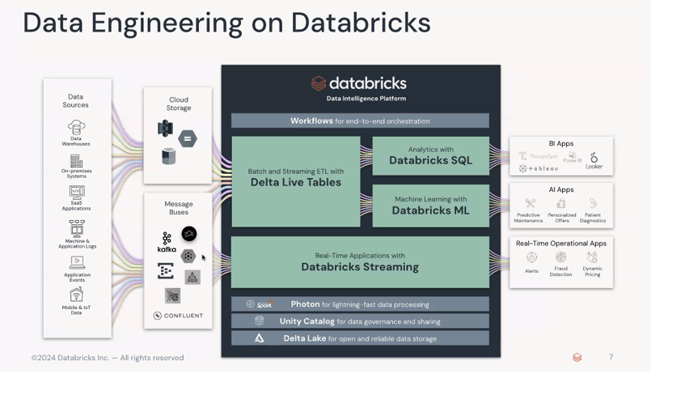
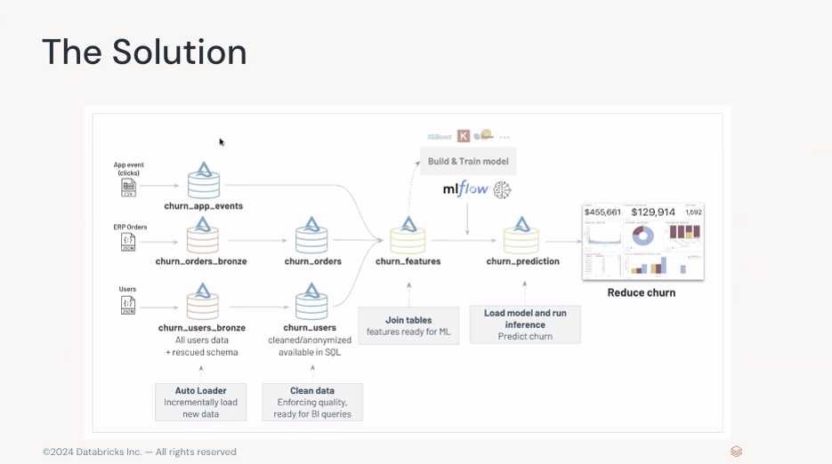
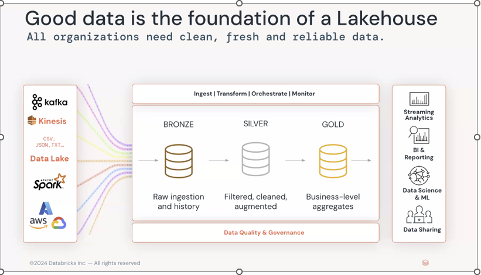
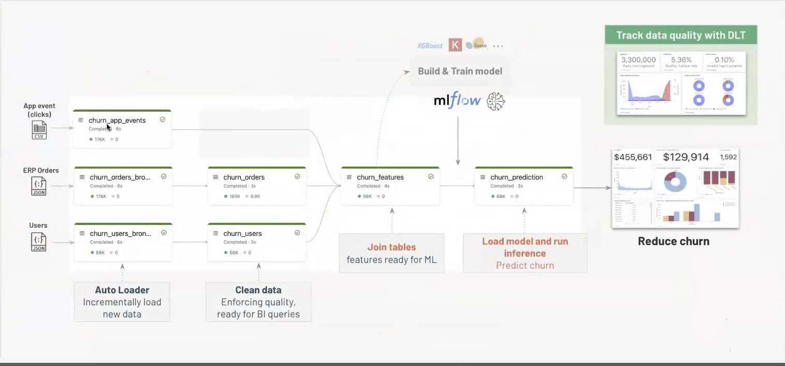
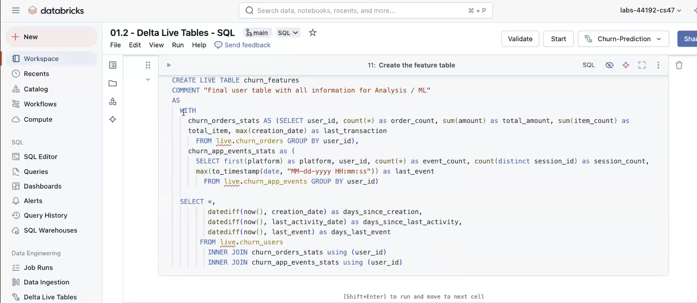
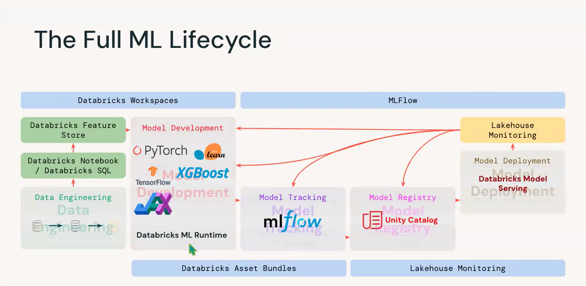
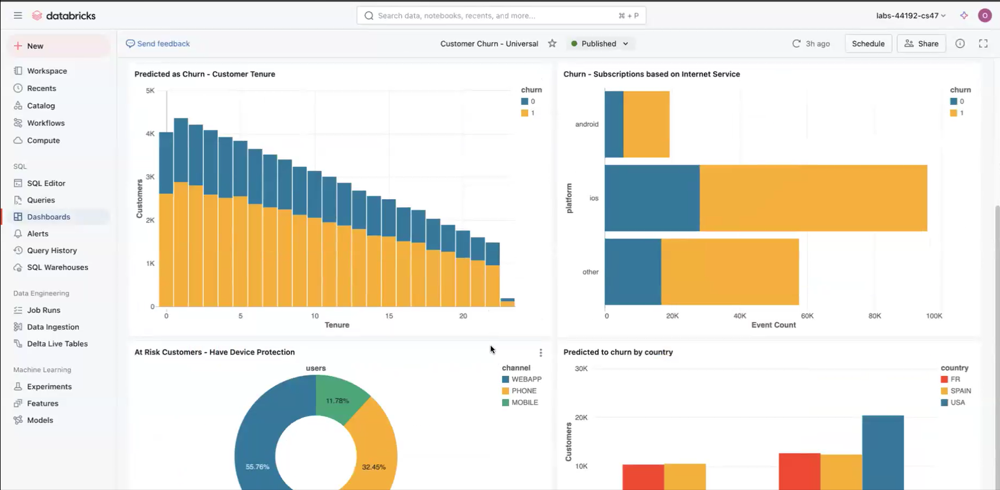

# Customer Churn Analytics & Prediction | Databricks Lakehouse

**Data Engineering · Delta Lake · PySpark · Delta Live Tables · MLflow · Databricks SQL · GCP**

> **Project context:** Hands-on Databricks learning-lab project using demonstration data and lab materials. This repository documents the notebooks, architecture, and reporting workflow. It is not a production deployment or a Power BI implementation.

## Project Overview

This project explores an end-to-end Customer 360 workflow for analyzing and predicting customer churn. Customer profiles, ERP orders, and application clickstream events are ingested and prepared in a Databricks Lakehouse. Curated customer features support machine-learning experimentation and SQL-based business intelligence.

**Business objective:** Bring customer data from separate systems into a consistent analytical foundation, identify customers potentially at risk of churn, and support retention-oriented analysis.

## Solution Architecture

The solution follows a **Medallion (Bronze → Silver → Gold)** approach:

| Layer | Purpose | Example in this project |
|---|---|---|
| Bronze | Preserve ingested source records | Application events, orders, and customer profiles |
| Silver | Clean, validate, and standardize records | Prepared user and order tables |
| Gold / features | Combine data for analytics and ML | `churn_features` |
| Prediction | Apply the trained model to customer features | `churn_prediction` |

## Technology Stack

| Area | Technologies |
|---|---|
| Platform | Databricks on Google Cloud Platform (GCP) |
| Ingestion & storage | Auto Loader, Delta Lake |
| Data transformation | PySpark, SQL, Delta Live Tables (DLT) |
| Quality controls | DLT expectations, schema handling |
| Machine learning | scikit-learn, MLflow |
| Analytics | Databricks SQL and native SQL dashboards |

**Power BI was not used in this project.**

## Implementation Walkthrough

### 1. Ingestion and Customer 360 Data Preparation

The data engineering notebook demonstrates incremental ingestion with Auto Loader, schema inference and evolution concepts, Delta Lake storage, and transformations to prepare customer-centric data for downstream use.

### 2. Delta Live Tables and Data Quality

The DLT notebooks show declarative table definitions and expectations that check whether ingested records conform to the expected schema. The pipeline links ingested application events, orders, and users to cleaned tables and analytical features.

### 3. Feature Engineering

Customer and activity data are joined into a feature table for churn analysis. Examples of features visible in the SQL notebook include order counts, total order amounts, event and session counts, and days since recent activity.

### 4. Machine Learning and Inference

The ML notebook explores churn modeling with scikit-learn and MLflow for experiment tracking. The inference notebook demonstrates generating predictions for downstream analysis. The lifecycle diagram below is a reference architecture from the Databricks training material, not proof that every production lifecycle component was deployed.

Additional training reference:

### 5. Databricks SQL Reporting

Databricks SQL queries and a native dashboard demonstrate analysis of predicted churn across customer tenure, subscription or platform activity, customer channels, and geography.

The charts are **illustrative outputs from the lab dataset**, not verified results for a real business.

## Notebook Guide

The notebooks are stored in [`notebooks/`](notebooks/). The recommended reading order is:

| Order | Notebook | Focus |
|---|---|---|
| 1 | `Introduction.py` | Project and platform orientation |
| 2 | `Data Engineering with Delta.py` | Ingestion and Delta transformations |
| 3 | `Delta Live Tables - Python.py` | DLT pipeline in Python |
| 4 | `Delta Live Tables - SQL.sql` | DLT pipeline and features in SQL |
| 5 | `Machine Learning with MLflow.py` | Training and experiment tracking |
| 6 | `Machine Learning - Inference.py` | Churn predictions |
| 7 | `BI and Data Warehousing.py` | Databricks SQL analysis |

These are **Databricks notebook exports**. Some commands depend on a configured Databricks workspace and lab-specific data; downloading the files alone does not guarantee they will run locally.

## Skills Demonstrated

- Lakehouse and Medallion architecture concepts
- Incremental ingestion and schema management
- PySpark and SQL transformations
- DLT pipeline construction and data quality expectations
- Customer 360 feature engineering
- MLflow experiment tracking and churn inference workflow
- Databricks SQL dashboards and business-oriented analytics

## Limitations and Future Improvements

- This is a learning-lab demonstration, not a production-grade customer churn system.
- Data provenance, model accuracy, and business impact are not independently validated here.
- A future iteration could use an independently sourced public dataset, add reproducible configuration and tests, document model metrics, and evaluate explainability and drift.

## Attribution

This portfolio project is based on Databricks training/lab materials. Architecture and lifecycle illustrations are credited to **Databricks** where indicated in the images. The repository documents hands-on practice and technical learning rather than claiming original authorship of the training assets.

---

**Repository focus:** Data Engineering → Data Quality → Feature Engineering → Machine Learning → Databricks SQL Analytics
